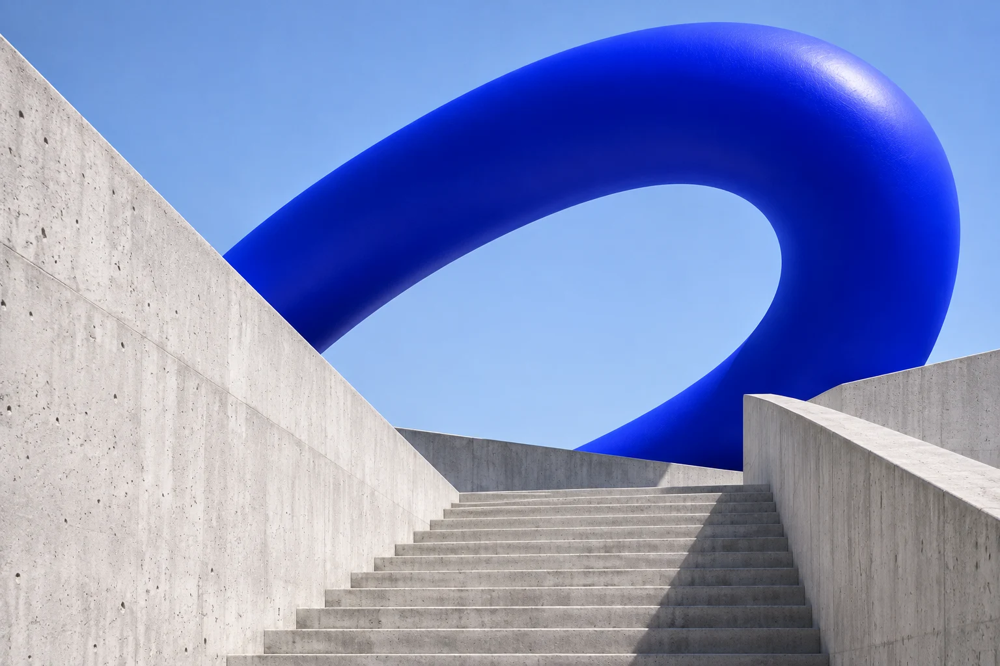

# TIME HEIST

**A webpage whose past is still touchable.**

[Open the experiment](https://jash65571.github.io/time-heist/)

Draw a lens into a live page’s history. Rewind only the area inside it. Grab a photo that disappeared, cross the blue edge, and bring it into the present.



## Try it

- Drag the photo beyond the blue circle, or choose **Bring to now**.
- Use the time slider. A mouse wheel inside the lens also rewinds it.
- Draw on empty space to make a new lens. Use **Move** or the lens handle to reposition it.
- Edit the words, change the light, or remove a photo. Find those changes in the timeline.
- Choose **Show me** for a short live demonstration.
- Double-click a recovered photo to view the artwork.

The page records real UI state. The lens and the current canvas are separate DOM layers using the same saved object model. Recovering creates a new live object; the historical snapshot stays intact.

## Built with

React, TypeScript, Vite, Three.js, and a small pure state-history engine. Geist is self-hosted. The original architectural artwork is included in the repository. No API keys, backend, login, or external runtime services are needed.

## Local development

```sh
npm ci
npm run dev
```

```sh
npm test
npm run build
npm run preview
```

The production build goes into `docs/`. Relative asset paths allow it to run under GitHub Pages project URLs. After making changes, run `npm run build` and commit the source and `docs/` together.

## GitHub Pages

Repository **Settings → Pages → Deploy from a branch → main → /docs**. Everything runs on GitHub Pages. `.nojekyll` keeps the static output untouched.

## Access and performance

Touch controls include a large time slider and a tap-to-recover option. Keyboard controls: **L** to draw, **V** to move, **?** for help, arrow keys on a selected photo or lens handle, and **Delete** to remove a photo. Native dialogs retain focus. Reduced-motion preferences are respected. WebGL has a CSS fallback; rendering pauses when the scene is offscreen or the tab is hidden.

Timelines stay in local browser storage. Only the latest 80 snapshots are kept. Reset starts a new local recording. Nothing is sent to a server.

## Credits

Built by [Jash Patel](https://github.com/jash65571). Visual direction inspired by [Lusion](https://lusion.co/). The implementation and artwork were created for TIME HEIST. The reference site’s source, logo, and licensed fonts are not bundled. Geist is distributed under the SIL Open Font License.
